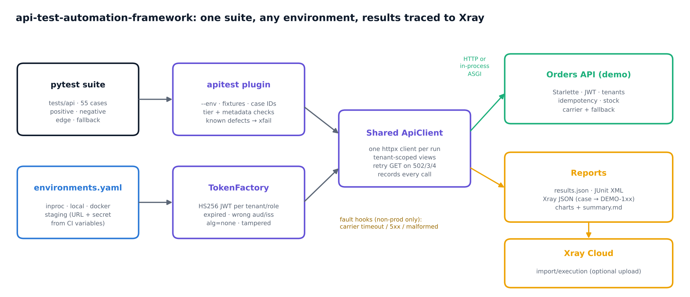
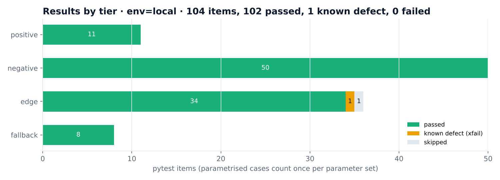
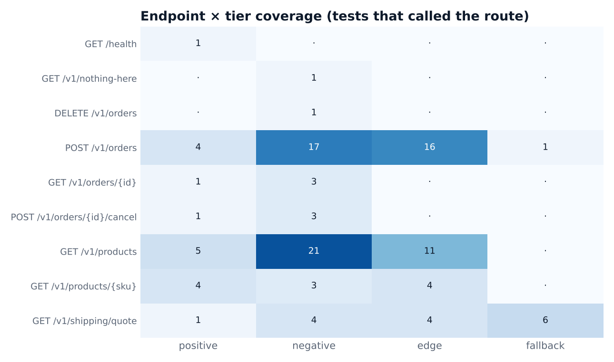
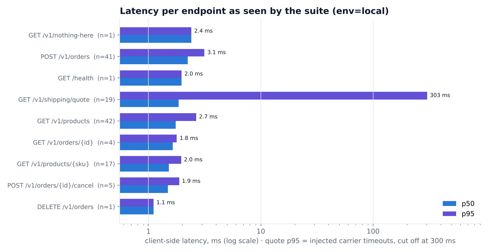

# API Test Automation Framework

[](https://github.com/vishavjit-singh/api-test-automation-framework/actions/workflows/ci.yml)


An API regression framework built on **pytest + httpx**. One suite runs unchanged against an in-process app, a local server, a Docker container or a deployed environment; `--env` picks the target. It includes:

- a **JWT helper** that signs valid tokens for any tenant and role set, plus every kind of broken token negative tests need
- a **shared, tenant-scoped HTTP client** with safe retries
- four **test tiers** (positive, negative, edge, fallback)
- **Xray traceability**: every test carries a stable case ID that maps to a Jira/Xray test issue, and each run produces an Xray JSON import

It ships with a demo multi-tenant **Orders API** to test against: JWT auth, tenant isolation, idempotent orders, stock and an upstream carrier with fallback. 55 cases (104 pytest items) run against it in about a second.



## Why this project

| Problem in API regression testing | How the framework handles it |
|---|---|
| Tests hard-code a URL and a token, so they only run in one place | `config/environments.yaml` plus `--env inproc|local|docker|staging`. URLs and secrets for real targets come from environment variables, never from the repo |
| Auth tests need tokens that are wrong in specific ways | `TokenFactory`: expired, not-yet-valid, wrong audience or issuer, bad signature, `alg=none`, tampered payload, missing claims |
| Multi-tenant APIs leak data across tenants | The client hands out **tenant-scoped views** (`api.as_tenant("acme", roles=...)`). Tests check that another tenant's resources read as **404**, not 403 |
| Copy-pasted `requests` calls with different headers, timeouts and retry habits | One shared `httpx` client per run. Retries apply only to GET/HEAD on 502/503/504 and connection errors, so a retry can never create a second order |
| A failing assertion says `assert 403 == 200` and nothing else | `expect(resp, status, code)` failures show method, URL, redacted headers, request ID and body |
| Dependencies fail in production but never in tests | **Fallback tier**: fault hooks make the carrier time out, return 5xx or send garbage. Tests check fallback rates, the latency budget, orders still accepted and the circuit breaker |
| Test results live in CI logs while the test plan lives in Jira | `@pytest.mark.case("API-TC-021")` → `xray/mapping.yaml` → **Xray JSON** with iterations, statuses and linked defects; optional upload to Xray Cloud |
| Known bugs are either deleted tests or permanently red | `@pytest.mark.known_defect("DEMO-301", ...)` becomes a **strict xfail** linked to the defect. When the bug is fixed the run fails until the marker is removed |
| Test metadata rots | The plugin refuses to collect a test without a case ID or tier, or with a duplicated ID |

## Results from the demo run

`make demo` starts the demo service with uvicorn, runs the whole suite against it **over real HTTP**, then renders these images from the run's own `results.json` and `requests.jsonl`.



One item is a **known defect** (`DEMO-301`, seeded on purpose in the demo service: `limit=0` returns 500 instead of 422). One item is skipped: it builds a separate production-mode app, which is only possible in-process. Items are counted once per tier, so the test that is both fallback and negative appears in both rows.

**Endpoint × tier coverage**, from the HTTP calls each test actually made:



**Client-side latency per endpoint.** This is diagnostic, not a load test. The 300 ms p95 on the quote endpoint is the injected carrier timeout being cut off by the service:



| Metric (demo run, `--env local`) | Value |
|---|---|
| Cases / pytest items | 55 / 104 (parametrised cases run once per parameter set) |
| Outcome | 102 passed · 1 known defect (strict xfail, DEMO-301) · 1 skipped (in-process only) |
| HTTP calls made by the suite | 161, across 10 routes, 0 retries needed |
| Suite time | about 1 s of test time, most of it 300 ms carrier timeouts |
| Framework unit tests | 33 (config, tokens, client retries and redaction, Xray mapping and upload, plugin rules via `pytester`) |

The Xray JSON import produced by the same run (excerpt from `reports/xray-results.json`):

```json
{
  "info": {
    "summary": "API regression · local",
    "description": "55 Xray tests from 104 pytest items",
    "testEnvironments": ["local"],
    "testPlanKey": "DEMO-100",
    "project": "DEMO"
  },
  "tests": [
    {
      "testKey": "DEMO-104",
      "status": "PASSED",
      "comment": "API-TC-004: all checks passed",
      "iterations": [
        {"name": "wrong_audience", "parameters": [{"name": "case", "value": "wrong_audience"}], "status": "PASSED"},
        {"name": "wrong_issuer", "parameters": [{"name": "case", "value": "wrong_issuer"}], "status": "PASSED"}
      ]
    },
    {
      "testKey": "DEMO-121",
      "status": "FAILED",
      "comment": "tests/api/test_products.py::test_limit_zero_is_rejected: xfailed (DEMO-301: limit=0 returns 500 instead of 422)",
      "defects": ["DEMO-301"]
    }
  ]
}
```

> The Jira keys (`DEMO-1xx`, `DEMO-301`) belong to a fictional project. Point [`xray/mapping.yaml`](xray/mapping.yaml) at your own Xray tests. The demo service, its tenants (`acme`, `globex`) and its catalogue are synthetic.

## Writing a test

```python
@pytest.mark.case("API-TC-013")          # stable ID → Xray DEMO-113
@pytest.mark.negative                    # tier
@pytest.mark.smoke                       # also part of the post-deploy subset
def test_other_tenants_order_reads_as_not_found(globex, place_order):
    """An acme order id requested by globex → 404 (not 403: no existence leak)"""
    order = place_order()                                   # created as tenant acme
    expect(globex.get(f"/v1/orders/{order['id']}"), 404, "not_found")
```

Fixtures from the plugin: `env`, `tokens`, `api` (shared client), `acme` and `globex` (tenant views with all roles), `admin`, and `hooks` (fault injection, which skips itself where hooks are disabled). Contracts in [`apitest/schemas.py`](apitest/schemas.py) validate response shapes with pydantic.

## Quickstart

```bash
git clone https://github.com/vishavjit-singh/api-test-automation-framework.git
cd api-test-automation-framework
python -m venv .venv && source .venv/bin/activate
make install
make test        # 33 unit tests + the API suite in-process: 136 passed, 1 xfailed
make demo        # real HTTP: start service → suite → reports/ → docs/images → catalogue → Xray dry run
```

### Other targets

```bash
make serve                          # terminal 1: the demo API on :8000
make test-api ENV=local             # terminal 2: the suite over HTTP
make smoke ENV=local                # 9-item smoke subset

make up                             # docker compose: api + tests containers, reports in ./reports

export STAGING_API_URL=https://api.staging.example.test API_JWT_SECRET=...
make test-api ENV=staging           # fallback tier skips itself: no fault hooks on staging
```

### Xray

```bash
python -m apitest xray-upload                 # dry run: validates and counts what would be sent
XRAY_CLIENT_ID=... XRAY_CLIENT_SECRET=... python -m apitest xray-upload --send
pytest tests/api --xray-flavor server         # PASS/FAIL statuses for Xray Server/DC
pytest tests/api --xray-strict                # fail the run if any case has no Xray mapping
```

The manual [`staging.yml`](.github/workflows/staging.yml) workflow runs the suite against a deployed environment using repository secrets, with an option to import the results into Xray.

## Project structure

```
├── apitest/                    # the framework
│   ├── config.py               # environment selection, ${VAR} expansion, secret handling
│   ├── auth.py                 # TokenFactory: valid and deliberately broken JWTs
│   ├── client.py               # shared httpx client, tenant views, safe retries, recorder, expect()
│   ├── plugin.py               # pytest plugin: --env, fixtures, metadata checks, known defects, reports
│   ├── schemas.py              # response contracts (pydantic)
│   ├── xray.py                 # case → Xray key mapping, JSON import, Cloud upload
│   └── report.py               # charts + summary.md from a run
├── demo_service/               # system under test: Starlette Orders API + simulated carrier
├── tests/api/                  # 55 cases: auth, tenancy/roles, products, orders, shipping/fallback, contract
├── tests/unit/                 # 33 framework tests
├── config/environments.yaml    # inproc · local · docker · staging
├── xray/mapping.yaml           # API-TC-### → DEMO-1##
├── docs/TEST_PLAN.md           # scope, tiers, environments, exit criteria, defect log
├── docs/TEST_CATALOGUE.md      # generated from the test code
├── tools/serve_and_test.py     # make demo
├── Dockerfile · docker-compose.yml · Makefile
└── .github/workflows/          # ci.yml (matrix, HTTP, compose) · staging.yml (manual)
```

## Testing the framework itself

```bash
make lint && make test-unit
```

- **Tokens:** each broken-token helper fails PyJWT validation in the intended way, and tampering keeps the old signature
- **Client:** auth, tenant and request-ID headers; overriding and removing headers; GET retried on 503; POST never retried; connection errors retried then raised; route templating; tokens redacted in failure messages
- **Xray:** iterations, Cloud and Server statuses, defects on xfail, unmapped cases reported (never invented), duplicate keys rejected, upload calls authenticate then import (mocked transport)
- **Plugin** (`pytester`): missing or duplicate case IDs, a missing tier, strict xfail for known defects, a fixed defect failing the run, `--xray-strict`

## Limitations and roadmap

- The demo service is built on **Starlette**, the ASGI toolkit underneath FastAPI. The framework itself is service-agnostic: it only needs a base URL, or an ASGI app for in-process runs.
- Tokens are HS256 with a shared secret. RS256 with a JWKS endpoint, and OAuth client-credentials token fetching for real identity providers, are next.
- Latency numbers come from a laptop-class run against localhost and are not a performance benchmark.
- Next: OpenAPI-driven contract tests (schemathesis), parallel runs with `pytest-xdist`, and test-data factories per tenant.

## Author

**Vishavjit Singh Saini**, Data Engineer
[Portfolio](https://vishavjit-singh.pages.dev/) · [LinkedIn](https://www.linkedin.com/in/vishavjit-singh-7011211ab/) · [GitHub](https://github.com/vishavjit-singh)

## License

[MIT](LICENSE)
